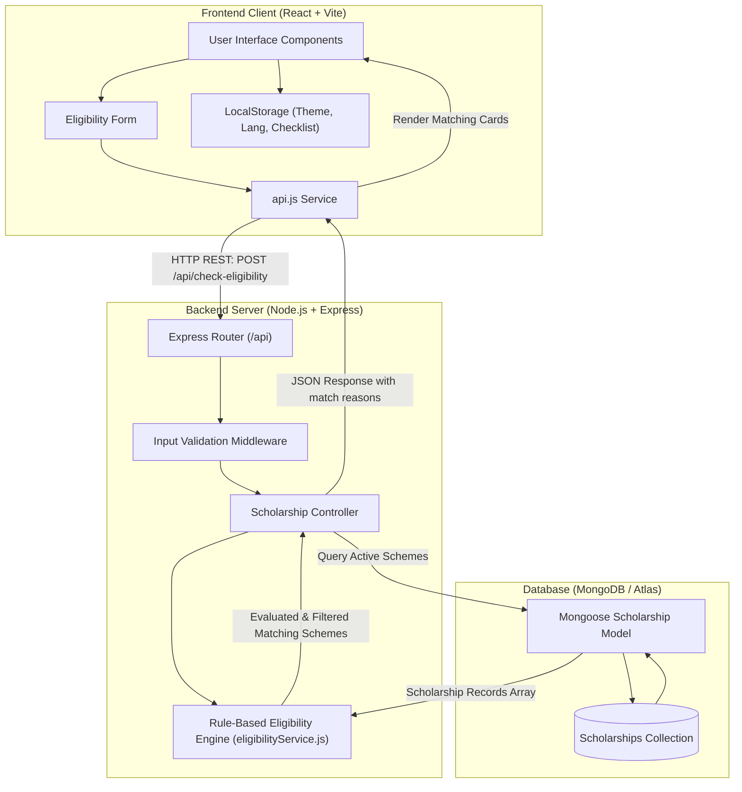

# System Architecture Diagram

SCHEME CONNECT is designed as a clean, decoupled 3-tier full-stack web application.

## Architecture Summary for Viva

1. **Presentation Layer (React + Vite)**:
   - Captures user inputs (category, income, education level, percentage, disability status, domicile).
   - Manages interactive local state (English/Marathi translations, light/dark themes, document checklist progress).
   - Communicates exclusively via a centralized API service module.

2. **Application / Business Logic Layer (Node.js + Express)**:
   - Validates input format and boundaries.
   - Houses the deterministic rule-based evaluation engine.
   - Does not rely on black-box AI; uses clear boundary conditions that are auditable and easily verified.

3. **Data Layer (MongoDB + Mongoose)**:
   - Houses verified scholarship records with criteria fields (`eligibleCategories`, `maximumIncome`, `minimumPercentage`, etc.).
   - Schema-indexed on categorical fields for efficient queries.
