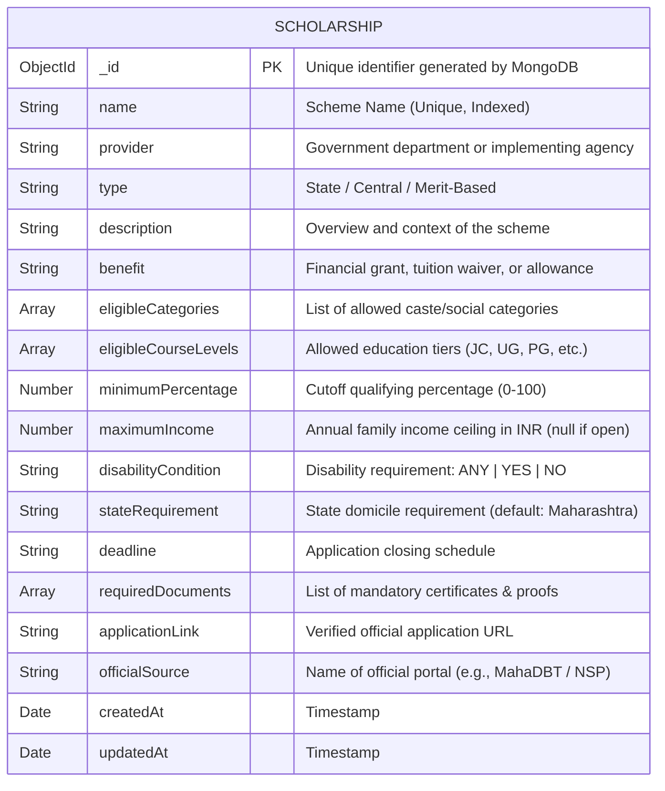

# Database & Entity-Relationship (ER) Documentation

## Schema Field Descriptions & Types

| Field Name | Type | Constraints / Default | Description |
| :--- | :--- | :--- | :--- |
| `_id` | ObjectId | Primary Key | Auto-assigned by MongoDB |
| `name` | String | Required, Unique, Trim | Full official title of the scheme |
| `provider` | String | Required, Trim | Department or ministry offering the scheme |
| `type` | String | Required | Classification (e.g. State Government, Central) |
| `description` | String | Required | Plain English overview of the scholarship |
| `benefit` | String | Required | Explicit monetary/waiver entitlement |
| `eligibleCategories` | [String] | Required, Indexed | Array of allowed categories (Open, SC, ST, OBC, etc.) |
| `eligibleCourseLevels` | [String] | Required, Indexed | Applicable courses (Junior College, UG, PG, etc.) |
| `minimumPercentage` | Number | Default: 0, Range 0-100 | Academic cutoff score |
| `maximumIncome` | Number | Nullable | Max annual family income threshold (null = no ceiling) |
| `disabilityCondition` | String | Enum: `['ANY', 'YES', 'NO']` | PwD requirement filter |
| `stateRequirement` | String | Default: `'Maharashtra'` | Target state domicile |
| `deadline` | String | Required | Application period deadline |
| `requiredDocuments` | [String] | Array of Strings | Checklist of documents to attach |
| `applicationLink` | String | Required | Verified portal URL |
| `officialSource` | String | Required | Official authority name |
